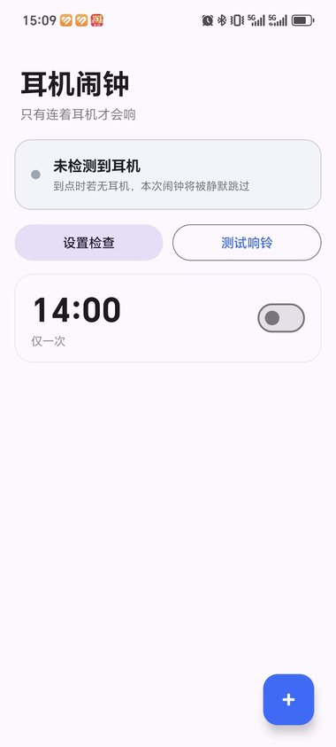
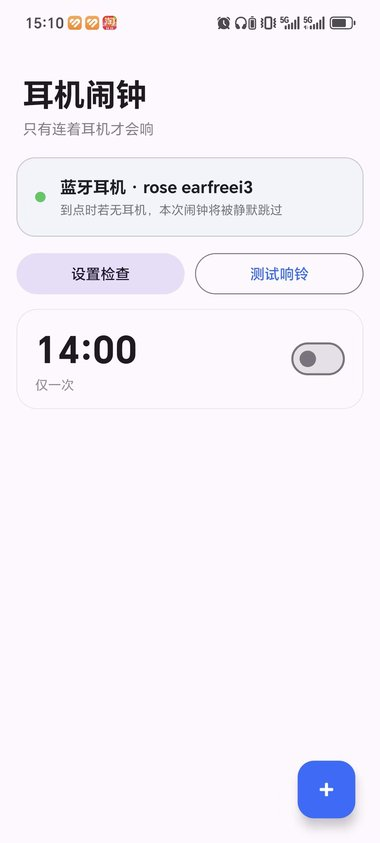
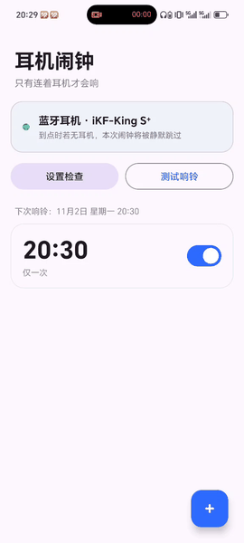
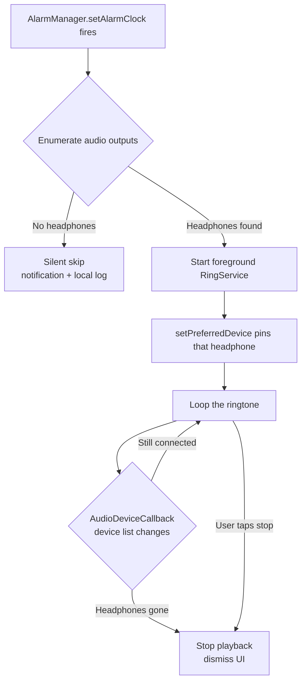

# EarAlarm

[简体中文](README.md) | **English**

[](https://developer.android.com)
[](https://developer.android.com)
[](https://kotlinlang.org)
[](LICENSE)

> An Android alarm clock that **only rings through your headphones**. No headphones connected? It stays silent. Unplug them mid-ring? It mutes instantly.
>
> Built for dorms, shared flats, and sleeping next to someone — you get woken up, the whole room doesn't. It works just as well in a library: set a nap alarm that stays in your ears instead of cutting through a silent reading room.

---

## Preview

| Main · No headphones | Main · Headphones connected | Ringing |
|:---:|:---:|:---:|
|  |  |  |

**Full flow**: set an alarm → rings exactly on time → unplug, instantly silent



---


## Why

A phone's built-in alarm has two modes: loud, or off. Neither works in a shared space:

- **Dorm** — sound on means your 6:30 AM alarm wakes three roommates too; vibrate-only is imperceptible from a desk.
- **Library** — a 25-minute nap alarm at full volume makes every head in the reading room turn.
- **Shared flat / sleeping next to someone** — any speaker output is a disturbance.

So this app inverts the model: **the alarm only rings when headphones are connected**. Earbuds in, and the sound goes into your ears alone. Forget them, and the alarm quietly skips instead of blasting the room.

For library use, set a short ring duration (10–15 seconds) — long enough to wake you, short enough not to draw stares.

## Features

| Feature | Description |
|---|---|
| 🎧 **Headphone-only ringing** | Checks the active audio output at trigger time; no headphones means a **silent skip**, never speaker playback |
| 🔌 **Instant mute on disconnect** | Listens to audio device changes for the whole ring. Unplug, or lose Bluetooth — playback **stops immediately** |
| 🔒 **Fires while locked** | `AlarmManager.setAlarmClock()` plus a foreground service. Works from lock screen, background, and Doze |
| 🌙 **Wakes the screen** | Turns the display on and shows a full-screen stop UI, no unlock needed |
| 📅 **Repeat and label** | Weekly repeat, custom labels, configurable ring duration |
| 📊 **Skipped rings are logged** | If no headphones were connected, you get a low-priority notification and a local record — you know it was *skipped*, not broken |
| 🔁 **Survives reboots** | Re-registers every alarm after boot, timezone change, or manual clock change |
| 📱 **Per-OEM guidance** | Detects Honor / Huawei / Xiaomi / OPPO / vivo / Samsung and shows the exact settings path for that ROM |

## How it works

The hard part isn't scheduling — it's **knowing the headphones are still there**. Three pieces form the backbone:



### 1. Firing on time

`AlarmManager.setAlarmClock()` is the highest-priority alarm API on Android. It is exempt from Doze and does not require a live process — the system brings the app back up at the trigger instant. A `FOREGROUND_SERVICE_MEDIA_PLAYBACK` service keeps playback alive while the screen is off.

### 2. Detecting headphones

Android exposes no "is it on my ears" API. The most reliable signal available is **whether a headphone-class output device currently exists**, enumerated via `AudioManager.getDevices(GET_DEVICES_OUTPUTS)`. Seven device types are covered:

```kotlin
TYPE_WIRED_HEADSET      // wired headset with mic
TYPE_WIRED_HEADPHONES   // wired headphones
TYPE_USB_HEADSET        // USB / Type-C
TYPE_BLUETOOTH_A2DP     // Bluetooth audio (the common case)
TYPE_BLUETOOTH_SCO      // Bluetooth call channel
TYPE_BLE_HEADSET        // BLE headset (API 31+)
TYPE_HEARING_AID        // hearing aids
```

### 3. Muting on disconnect (the critical part)

Checking once at trigger time is not enough — Bluetooth earbuds can slip out of range while you roll over. So an `AudioDeviceCallback` stays registered for the whole ring. The moment the device list changes and the headphone disappears:

1. `stop()` the player outright — not fade out, stop
2. Dismiss the ring screen and remove the notification
3. Log a "disconnected mid-ring" entry

This is the constraint I care about most: **a missed alarm is acceptable, accidental speaker playback is not.**

## Getting started

### Option 1 — Install the APK

Grab the latest APK from [Releases](../../releases) and sideload it. Android will warn about installing from unknown sources; allow it.

### Option 2 — Build from source

```bash
git clone https://github.com/Chen1Motong/EarAlarm.git
cd EarAlarm
./gradlew assembleDebug
# output: app/build/outputs/apk/debug/app-debug.apk
```

Requires JDK 17+, Android SDK Platform 34, and Build-Tools 34.0.0. Gradle itself is fetched by the wrapper.

## First run: permissions you must grant

Out of the box the alarm **will not fire** on many Chinese OEM ROMs, because their background restrictions kill anything that isn't whitelisted. Open the app → **Setup Check** and work through the list:

| Permission | Why | Auto-detectable |
|---|---|---|
| Notifications | A foreground service requires a persistent notification | ✅ |
| Exact alarms | Required for precise scheduling on Android 12+ | ✅ |
| Ignore battery optimization | Prevents the process from being frozen when idle | ✅ |
| Display over other apps | Lets the ring screen come to the front from the background (essential on Chinese ROMs) | ✅ |
| Autostart / background activity | Stops the system from killing the app before the alarm | ❌ manual |
| Start on boot | Re-registers alarms after a reboot | ❌ manual |

> **Note:** autostart, background activity, and boot-start have **no query API available to third-party apps**. The app can only show you the exact menu path for your device — you have to toggle them yourself. That's an Android platform limitation, not laziness.

### Settings path by manufacturer

| Brand | ROM | Key setting |
|---|---|---|
| Honor / Huawei | MagicOS / HarmonyOS | App launch management → disable "auto-manage" → allow autostart, associated launch, background activity |
| Xiaomi / Redmi | HyperOS / MIUI | Autostart + battery saver set to "No restrictions" |
| OPPO / realme | ColorOS | Autostart + allow full background behavior |
| vivo / iQOO | OriginOS | Autostart + allow high background power usage |
| Samsung | One UI | Battery → Background usage limits → Never sleeping apps |

## Known limitations

**1. It detects "connected", not "worn"**

There is no public in-ear detection API. So: **headphones sitting on the desk still count, and the alarm will ring**. True wear detection exists only inside the earbuds themselves (AirPods and similar) over vendor-private protocols. This cannot be worked around.

**2. Bluetooth earbuds paired to both phone and laptop may misbehave**

Some devices route audio to the other connected endpoint, which can change the phone's device list. If this happens on your hardware, please open an issue with your model.

**3. Chinese OEM permissions must be configured by hand**

No app can do this for you. If the alarm still doesn't fire, check that all three toggles under app launch management are genuinely on, that boot-start is enabled, and that "flip to mute" is off — that last one silences alarms whenever the phone is face-down and is very hard to diagnose.

## Project structure

```
app/src/main/java/com/earalarm/
├── Alarm.kt              data model and serialization
├── AlarmStore.kt         local persistence (SharedPreferences + JSON)
├── AlarmScheduler.kt     setAlarmClock scheduling and cancellation
├── AlarmReceiver.kt      trigger entry point (with headphone pre-check)
├── BootReceiver.kt       re-registers after boot / timezone change
├── RingService.kt        foreground service: playback, routing, disconnect watch
├── RingActivity.kt       full-screen ring UI (lock-screen capable)
├── HeadphoneDetector.kt  device enumeration and priority selection
├── DeviceProfile.kt      manufacturer detection and setup paths
├── SetupActivity.kt      permission checklist screen
├── SkipLog.kt            skipped-ring history
└── MainActivity.kt       main screen: list, edit, test ring
```

Stack: Kotlin + ViewBinding + Material 3. No third-party dependencies beyond AndroidX.

## Roadmap

- [ ] Gradual volume ramp (10% → 100%, so you're not jolted awake)
- [ ] Snooze on the ring screen (currently stop-only)
- [ ] Ringtone selection (bundled tones + pick from local music)
- [ ] Per-alarm volume
- [ ] English / Traditional Chinese UI

## Contributing

Issues and PRs are welcome — especially **device compatibility reports**. If it works (or fails) on your ROM, please include the model, OS version, and what happened. That's genuinely useful to the next person.

## License

[MIT](LICENSE) © 2026 陈墨瞳
