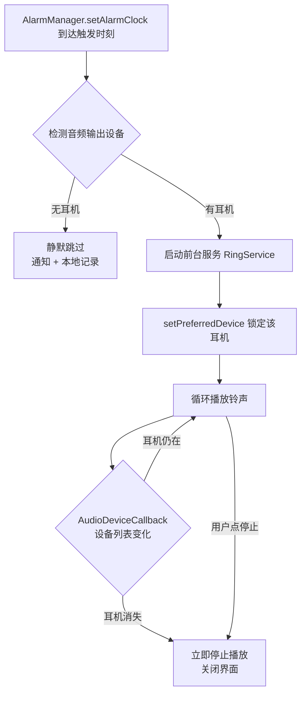

# EarAlarm · 耳机闹钟

**简体中文** | [English](README.en.md)

[](https://developer.android.com)
[](https://developer.android.com)
[](https://kotlinlang.org)
[](LICENSE)

> 一个**只通过耳机响铃**的安卓闹钟：没插耳机就不响，响到一半拔出耳机就立刻静音。
>
> 给住在宿舍、合租，或者睡在别人旁边的人用——早上被叫醒，但不会把整个房间吵醒。

---

## 为什么做这个

手机自带的闹钟只有两种状态:响，或者关闭。但在宿舍里这两样都不合适:

- 开声音，六点半的闹钟会把三个室友一起叫醒；
- 关声音只振动，放在桌上根本感觉不到。

于是有了这个 App:**闹钟只在你戴上耳机时才响**。你把耳机塞进耳朵睡觉，早上的声音只进你一个人的耳朵。如果忘了戴，它不会外放，而是安静地跳过这次。

## 核心特性

| 特性 | 说明 |
|---|---|
| 🎧 **仅耳机响铃** | 到点时检测当前音频输出，没有耳机设备就**静默跳过**，绝不外放 |
| 🔌 **断连立即静音** | 响铃全程监听音频设备变化，耳机一拔/蓝牙一断，**立刻停止**并关闭界面 |
| 🔒 **锁屏照响** | 基于 `AlarmManager.setAlarmClock()` + 前台服务，锁屏、后台、Doze 休眠下都能准时触发 |
| 🌙 **熄屏自动亮屏** | 响铃时自动点亮屏幕并弹出全屏停止界面，不用先解锁 |
| 📅 **重复与标签** | 支持周重复、自定义标签、响铃时长 |
| 📊 **跳过有记录** | 没戴耳机被跳过时留一条低优先级通知 + 本地记录，让你知道是"被跳过"而不是"坏了" |
| 🔁 **重启自动恢复** | 开机、时区变更、时间修改后自动重新注册所有闹钟 |
| 📱 **机型自适应** | 自动识别荣耀/华为/小米/OPPO/vivo/三星，给出对应系统的准确设置路径 |

## 工作原理

需求里最难的一点不是"定时"，而是"**怎么知道耳机还在**"。这三个环节是整个 App 的骨架:



### 1. 准时触发

用 `AlarmManager.setAlarmClock()`——这是系统里优先级最高的闹钟 API。它不受 Doze 休眠限制，也不依赖 App 进程存活，系统会在到点时把进程拉起来。配合 `FOREGROUND_SERVICE_MEDIA_PLAYBACK` 前台服务，锁屏状态下也能持续播放。

### 2. 耳机判定

Android 没有"戴在耳朵上"的通用 API。能拿到的最准确信号是**当前是否存在耳机类输出设备**，通过 `AudioManager.getDevices(GET_DEVICES_OUTPUTS)` 枚举，覆盖 7 种类型:

```kotlin
TYPE_WIRED_HEADSET      // 带麦克风的有线耳麦
TYPE_WIRED_HEADPHONES   // 有线耳机
TYPE_USB_HEADSET        // USB / Type-C 耳机
TYPE_BLUETOOTH_A2DP     // 蓝牙音频（蓝牙耳机主要形态）
TYPE_BLUETOOTH_SCO      // 蓝牙通话通道
TYPE_BLE_HEADSET        // BLE 耳机（API 31+）
TYPE_HEARING_AID        // 助听设备
```

### 3. 断连静音（最关键的一环）

只判断"响铃开始时有没有耳机"是不够的——蓝牙耳机可能在你翻身时走出范围。所以响铃期间注册 `AudioDeviceCallback`，一旦设备列表变化且耳机消失:

1. 立刻 `stop()` 播放器（不是调低音量，是直接停）
2. 关闭响铃界面、移除通知
3. 记录一次"中途断开"

这是我最在意的一条:**宁可漏响，也绝不能突然从扬声器外放**。

## 快速开始

### 方式一：直接安装

从 [Releases](../../releases) 下载最新 APK，传到手机安装。安装时系统会提示"未知来源应用"，允许即可。

### 方式二：从源码构建

```bash
git clone https://github.com/<your-name>/EarAlarm.git
cd EarAlarm
./gradlew assembleDebug
# 产物：app/build/outputs/apk/debug/app-debug.apk
```

环境要求:JDK 17+、Android SDK Platform 34、Build-Tools 34.0.0。Gradle 由 Wrapper 自动下载。

## 首次使用：必须开的权限

装完直接设闹钟**大概率不会响**，因为国产 ROM 的后台管控会掐掉一切。打开 App →【设置检查】，按页面提示逐项开启:

| 权限 | 为什么需要 | 能否自动检测 |
|---|---|---|
| 通知权限 | 前台服务必须显示常驻通知 | ✅ |
| 精确闹钟 | Android 12+ 定时触发的前提 | ✅ |
| 忽略电池优化 | 防止息屏后进程被冻结 | ✅ |
| 悬浮窗 | 后台把响铃界面弹到最前（国产 ROM 尤其需要） | ✅ |
| 自启动 / 后台活动 | 防止到点前被系统杀掉 | ❌ 只能手动确认 |
| 开机启动 | 重启后重新注册闹钟 | ❌ 只能手动确认 |

> **说明**：自启动、后台活动、开机启动这三项，系统**没有向第三方 App 开放任何查询接口**。所以 App 只能按你的机型给出准确菜单路径，需要你自己点一遍并打勾。这不是偷懒，是安卓的现状。

### 各厂商设置路径

| 品牌 | ROM | 关键设置 |
|---|---|---|
| 荣耀 / 华为 | MagicOS / HarmonyOS | 应用启动管理 → 关闭"自动管理" → 允许自启动、关联启动、后台活动 |
| 小米 / Redmi | HyperOS / MIUI | 自启动管理 + 省电策略设为"无限制" |
| OPPO / realme | ColorOS | 自启动管理 + 允许完全后台行为 |
| vivo / iQOO | OriginOS | 自启动 + 允许后台高耗电 |
| 三星 | One UI | 电池 → 后台使用限制 → 从不休眠的应用 |

## 已知限制

**1. 判断不了"戴上"，只能判断"连着"**

系统层面没有入耳检测的开放 API。所以:**耳机插着但放在桌上，它照样会响**。真要判断耳朵上有没有，只能靠耳机自己的入耳检测（如 AirPods），走厂商私有协议，通用工具读不到。这个限制无法绕过。

**2. 蓝牙耳机同时连着手机和电脑时，可能不响**

部分机型会把音频路由到另一个已连接设备，此时手机侧的耳机设备列表可能变化。如果在你的设备上出现这种情况，欢迎提 issue 附上机型。

**3. 国产 ROM 的权限必须手动配**

这不是 App 能自己解决的。如果配完还是不响，请确认:`应用启动管理`的三个开关是否真的全开了、`开机启动`是否打开、以及有没有开"翻转静音"（手机一翻面闹钟就哑，很难排查）。

## 项目结构

```
app/src/main/java/com/earalarm/
├── Alarm.kt              闹钟数据模型与序列化
├── AlarmStore.kt         本地存储（SharedPreferences + JSON）
├── AlarmScheduler.kt     AlarmManager.setAlarmClock 调度与取消
├── AlarmReceiver.kt      闹钟触发入口（含耳机预检）
├── BootReceiver.kt       开机/时区变更后重新注册
├── RingService.kt        前台服务：播放、音频路由、断连监听
├── RingActivity.kt       全屏响铃界面（锁屏可弹出）
├── HeadphoneDetector.kt  耳机设备枚举与优先级选择
├── DeviceProfile.kt      机型识别与厂商设置路径
├── SetupActivity.kt      权限检查清单页
├── SkipLog.kt            跳过记录
└── MainActivity.kt       主界面：列表、编辑、测试响铃
```

技术栈:Kotlin + ViewBinding + Material 3，无第三方依赖，除 AndroidX 外零外部库。

## Roadmap

- [ ] 渐强音量（从 10% 缓慢升到 100%，避免突然惊醒）
- [ ] 响铃界面的贪睡功能（目前只有"停止"）
- [ ] 多套音源选择（内置铃声 + 从本地音乐选取）
- [ ] 按闹钟单独设置音量
- [ ] 英语 / 繁体中文界面

## 贡献

欢迎提 issue 和 PR。特别是**机型适配反馈**——如果你在某个 ROM 上跑通了或者跑不通，请附上机型、系统版本和现象，这对其他人很有用。

## License

[MIT](LICENSE) © 2026 陈墨瞳
